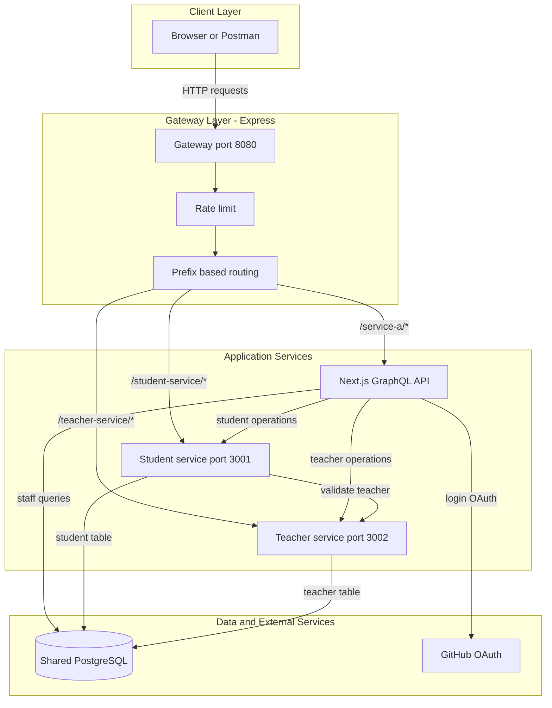

# Architecture Diagram

Aplikasi GraphQL menggunakan Express Gateway untuk merutekan request ke API Next.js, student-service, dan teacher-service. Student-service bergantung pada teacher-service saat memvalidasi teacher untuk pembuatan atau perubahan student.

## Application Architecture

<!-- mermaid-checked: no \n, no em-dash/en-dash, no {} in labels, subgraphs are id["label"], arrows are -->|"label"|, all subgraphs closed by end, ids unique -->

### Technology Stack Summary

| Layer | Technology | Version | Purpose |
|---|---|---|---|
| Client | Browser or Postman | N/A | Sends HTTP requests through the gateway |
| Gateway | Node.js, Express, http-proxy-middleware | Express ^5.1.0, proxy ^3.0.5 | Rate limiting and routing to application services |
| GraphQL API | Next.js, Apollo Server, GraphQL | Next.js 16.3.4, Apollo ^5.5.1, GraphQL ^16.14.2 | Existing GraphQL API, staff data, and authentication |
| Student service | Node.js, Express, `pg` | Express ^5.1.0, `pg` ^8.23.0 | Owns student queries and mutations; validates teacher assignments |
| Teacher service | Node.js, Express, `pg` | Express ^5.1.0, `pg` ^8.23.0 | Owns teacher queries |
| Data | PostgreSQL | Configured by `DATABASE_URL` | Stores student, teacher, and staff records |
| External identity | GitHub OAuth | N/A | Provides the sign-in flow for the web application |

### Data Storage & External Services

Student-service, teacher-service, and the remaining staff GraphQL resolvers currently use the same PostgreSQL database configured by `DATABASE_URL`; student-service handles the `students` table and teacher-service handles the `teachers` table. Sharing a database keeps the existing GraphQL data model intact for this exercise, but is not full database isolation between microservices. GitHub OAuth remains integrated with the Next.js application.

### Key Architectural Decisions

- The GraphQL API delegates student and teacher operations to their respective services while retaining staff queries and authentication.
- Creating or updating a student calls teacher-service to verify the teacher; if that dependency is unavailable, student-service returns `503`.
- PostgreSQL remains persistent, so successfully created student records are not automatically reset when a service restarts.

## Component Relationships

```mermaid
flowchart LR
    subgraph cClientLayer["Client"]
        cClient["Browser or Postman"]
    end
    subgraph cGatewayLayer["Gateway"]
        cRateLimit["Rate limit middleware"]
        cApiKey["Optional API key check"]
        cProxy["Service proxy"]
    end
    subgraph cGraphLayer["GraphQL API"]
        cNext["Next.js API routes"]
        cApollo["Apollo GraphQL handler"]
        cAuth["JWT authentication"]
    end
    subgraph cStudentLayer["Student service"]
        cStudentApi["Student Express routes"]
        cStudentDb["Student queries and mutations"]
    end
    subgraph cTeacherLayer["Teacher service"]
        cTeacherApi["Teacher Express routes"]
        cTeacherDb["Teacher queries"]
    end
    subgraph cDataLayer["Data Access"]
        cPgPool["PostgreSQL connection pools"]
        cDatabase[("PostgreSQL")]
    end

    cClient -->|"HTTP"| cRateLimit
    cRateLimit --> cProxy
    cApiKey -.->|"checks teacher route"| cProxy
    cProxy -->|"/service-a/*"| cNext
    cProxy -->|"/student-service/*"| cStudentApi
    cProxy -->|"/teacher-service/*"| cTeacherApi
    cNext --> cApollo --> cAuth
    cApollo -->|"student operations"| cStudentApi
    cApollo -->|"teacher operations"| cTeacherApi
    cApollo -->|"staff queries"| cPgPool
    cStudentApi --> cStudentDb
    cStudentDb -->|"teacher validation"| cTeacherApi
    cStudentDb -->|"student table"| cPgPool
    cTeacherApi --> cTeacherDb
    cTeacherDb -->|"teacher table"| cPgPool
    cPgPool --> cDatabase
```

<!-- mermaid-checked: no \n, no em-dash/en-dash, no {} in labels, subgraphs are id["label"], arrows are -->|"label"|, all subgraphs closed by end, ids unique -->

### Component Inventory

| Component | Layer | Type | Responsibility |
|---|---|---|---|
| Express Gateway | Gateway | HTTP proxy | Routes client requests by service prefix |
| Rate limit middleware | Gateway | Middleware | Limits request rate per client IP |
| API key check | Gateway | Middleware | Optionally protects teacher-service gateway routes |
| Next.js API routes | GraphQL API | Web application | Hosts the existing GraphQL endpoint |
| Apollo GraphQL handler | GraphQL API | GraphQL API | Delegates student and teacher operations |
| JWT authentication | GraphQL API | Authentication helper | Verifies bearer tokens for protected GraphQL requests |
| Student Express routes | Student service | HTTP routes | Exposes student reads, creation, updates, deletion, and health check |
| Student queries and mutations | Student service | Data access | Reads and writes student records and validates teacher assignments |
| Teacher Express routes | Teacher service | HTTP routes | Exposes teacher reads and health check |
| Teacher queries | Teacher service | Data access | Reads teacher records from PostgreSQL |
| PostgreSQL connection pools | Data Access | Database clients | Executes parameterized SQL for owned records and staff queries |
