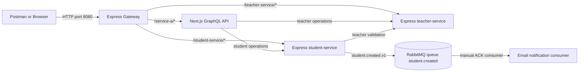

# Gateway Express

## Menjalankan secara lokal

Gunakan empat terminal dari root repository (`graphql-server`) untuk menjalankan aplikasi dan microservices:

Instal dependency satu kali:

```powershell
npm install
Set-Location .\student-service
npm install
Set-Location ..\teacher-service
npm install
Set-Location ..\gateway
npm install
```

Setelah itu, jalankan tiap aplikasi di terminal terpisah. Mulai dari root repository untuk Terminal 1:

```powershell
npm run dev
```

```powershell
Set-Location .\student-service
npm start
```

```powershell
Set-Location .\teacher-service
npm start
```

Jalankan gateway di terminal keempat:

```powershell
Set-Location .\gateway
npm start
```

Next.js GraphQL berjalan di port `3000`, student-service di `3001`, teacher-service di `3002`, dan gateway di `8080`. Kedua service memakai `DATABASE_URL` dari file `.env` root. Uji rute berikut melalui Postman:

| Request melalui gateway | Request ke service |
| --- | --- |
| `GET http://localhost:8080/service-a/api/hello` | `GET http://localhost:3000/api/hello` |
| `GET http://localhost:8080/student-service/students` | `GET http://localhost:3001/students` |
| `GET http://localhost:8080/teacher-service/teachers` | `GET http://localhost:3002/teachers` |

Rate limit berlaku untuk seluruh request: maksimal 20 request per 10 detik per alamat IP. Untuk menghasilkan urutan status normal lalu `429`, jalankan:

```powershell
Set-Location .\gateway
npm run test:rate-limit
```

## OpenAPI dan Swagger UI

Kontrak lengkap kedua service ada di [openapi.json](./openapi.json). Saat gateway berjalan, buka `http://localhost:8080/docs` untuk Swagger UI atau `http://localhost:8080/openapi.json` untuk JSON mentah. Endpoint diurutkan dalam dua grup: **Student Service** dan **Teacher Service**. Setiap grup mencakup skema permintaan/respons dan kode error; `POST /student-service/students` juga mendokumentasikan `409 Conflict` untuk nama student yang sama (tanpa membedakan kapitalisasi) dengan `teacher_id` yang sama.

Untuk screenshot dokumentasi, buka `/docs` dan pastikan kedua grup terlihat. Untuk screenshot `409`, pastikan database memiliki teacher, semua service berjalan, dan RabbitMQ aktif. Di bagian **Student Service → POST /student-service/students**, tekan **Try it out**, kirim contoh request, lalu kirim payload yang sama sekali lagi. Request pertama membuat data; request kedua harus menghasilkan `409`. Hapus student uji setelah mengambil bukti. Jika gateway memakai `API_KEY`, tekan **Authorize** dan masukkan nilai `X-API-Key`.

### Memeriksa drift kontrak

Jalankan dari folder `gateway`:

```powershell
npm run test:openapi-contract
```

Untuk merekam drift sebelum diperbaiki, hapus sementara respons `409` dari `POST /student-service/students` di `openapi.json`, jalankan perintah itu, lalu ambil screenshot hasil gagal. Kembalikan entri tersebut, jalankan lagi, dan ambil screenshot hasil `OpenAPI contract OK`. Jangan simpan perubahan drift sementara. Pemeriksaan ini juga memastikan grup endpoint dan perilaku `409` di service tetap tercakup dokumentasi.

Node.js 18 atau lebih baru diperlukan untuk `fetch` bawaan.

## Uji kegagalan service

Teacher-service memvalidasi teacher ketika student baru dibuat. Jika teacher-service mati, student-service mengembalikan `503` dengan pesan jelas dan tidak membuat data student. Daftar student tetap dapat dibaca karena operasi itu hanya membutuhkan student-service.

### Otomatis

Pastikan Next.js berjalan di port `3000`, lalu dari root repository jalankan:

```powershell
node .\smoke-test.js
```

Smoke test memulai student-service, teacher-service, dan gateway sendiri. Ia mencari teacher yang sudah ada di database, memastikan `GET /student-service/students` memberi `200`, menghentikan teacher-service dan memastikan `POST /student-service/students` memberi `503` sementara GET masih `200`, lalu menyalakan teacher-service kembali dan memastikan POST memberi `201`. Student uji dihapus setelah tes selesai. Database perlu berisi minimal satu teacher.

### Manual lewat Postman

Jalankan keempat proses seperti pada petunjuk di atas. Gunakan satu teacher yang sudah ada di database:

1. Kirim `GET http://localhost:8080/teacher-service/teachers`; catat `id` teacher.
2. Kirim `GET http://localhost:8080/student-service/students`; hasilnya harus `200`.
3. Tekan `Ctrl+C` di terminal teacher-service.
4. Kirim `POST http://localhost:8080/student-service/students` dengan body JSON berikut; ganti `teacher_id` dengan ID yang ada:

```json
{
  "nama": "Uji Microservice",
  "umur": 20,
  "tanggal": "2000-01-01",
  "teacher_id": 1
}
```

Hasil POST harus `503` dengan pesan bahwa teacher-service tidak tersedia. Kirim kembali `GET /student-service/students`; hasilnya harus tetap `200`.

Nyalakan kembali teacher-service (`npm start` di folder `teacher-service`) dan ulangi POST yang sama; hasilnya `201`. Data disimpan di PostgreSQL, bukan memori, jadi tidak otomatis kembali ke data awal. Hapus student uji dengan `DELETE http://localhost:8080/student-service/students/{id}` setelah mencatat respons.

### Uji timeout opsional

Di terminal teacher-service, set delay hanya untuk lookup teacher lalu mulai ulang service:

```powershell
$env:TEACHER_SERVICE_DELAY_MS = "5000"
npm start
```

Kirim POST student di atas. Student-service harus membalas `503` setelah batas timeout 2 detik. Hapus delay dengan menghentikan proses itu dan menjalankan `npm start` kembali tanpa variabel tersebut.

## Opsi API key

Salin `.env.example` menjadi `.env`, lalu isi `API_KEY` dengan nilai acak milik sendiri. Jika variabel ini diatur, request melalui `/teacher-service` harus membawa header `X-API-Key` dengan nilai yang sama; tanpa key, fitur ini tidak aktif. File `.env` tidak boleh di-commit. Jangan gunakan atau unggah rahasia dari file `.env` aplikasi.

Di Postman, kirim `GET http://localhost:8080/teacher-service/teachers` tanpa header untuk memastikan respons `401`. Tambahkan header `X-API-Key` dengan nilai dari `.env`, lalu kirim ulang untuk mendapatkan respons normal service (`200`).

## Diagram arsitektur

Diagram aplikasi dan jalur event RabbitMQ tersedia di [architecture-diagram.svg](./architecture-diagram.svg) dan [architecture-diagram.md](../.github/modernize/assessment/engines/facts/architecture-diagram.md).



## Refleksi

Dengan gateway, klien cukup mengetahui satu alamat dan satu port untuk mengakses beberapa service, sehingga konfigurasi klien lebih sederhana. Gateway juga dapat menerapkan rate limit dan pemeriksaan API key di satu tempat. Namun, gateway menjadi titik kritis: jika gateway mati, klien tidak dapat mengakses service mana pun melalui alamat tersebut meskipun servicenya masih berjalan. Karena itu, sistem produksi perlu mempertimbangkan pemantauan dan beberapa instance gateway agar ketersediaan tetap terjaga.

## Bahan laporan proyek

Lihat [rancangan keamanan dengan API Gateway](./rancangan-gateway.md) untuk diagram arsitektur, pembagian tanggung jawab, dan mitigasi risiko single point of failure.
