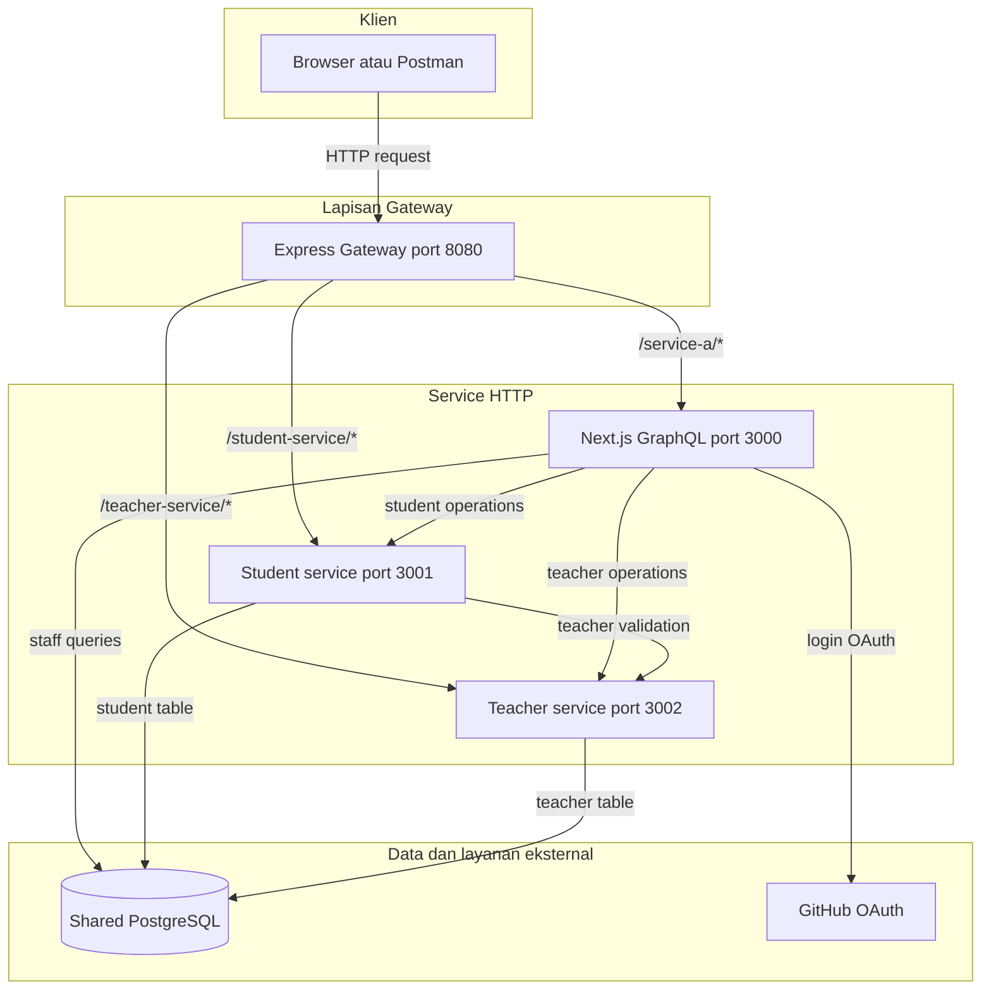

# 4.1 Rancangan Keamanan dengan API Gateway

Rancangan ini menjelaskan gateway Express sebagai satu pintu masuk HTTP bagi API GraphQL Next.js, student-service, dan teacher-service. Pembagian tanggung jawab di bawah mengikuti implementasi saat ini dan praktik umum; sesuaikan dengan keputusan spesifik hasil diskusi kelas sebelum dimasukkan ke laporan final.

## Diagram arsitektur

<!-- mermaid-checked: no \n, no em-dash/en-dash, no {} in labels, subgraphs are id["label"], arrows are -->|"label"|, all subgraphs closed by end, ids unique -->

Gateway menerima request pada port 8080, membatasi laju request, dan meneruskan prefix `/service-a/*`, `/student-service/*`, atau `/teacher-service/*` ke aplikasi yang sesuai. GraphQL mendelegasikan operasi student dan teacher ke service terkait, sementara student-service memvalidasi teacher lewat teacher-service saat membuat atau mengubah student. Semua service masih menggunakan PostgreSQL yang sama; pembagian tabel belum menjadi isolasi database penuh. API key untuk rute gateway teacher-service tersedia secara opsional (`API_KEY`); jika tidak diatur, pemeriksaan tersebut tidak aktif. Service `grpc-server.js` berjalan terpisah pada port 50051 dan belum dirutekan oleh gateway HTTP ini.

## Pembagian tanggung jawab

| Tanggung jawab | Pemilik | Alasan |
|---|---|---|
| Satu alamat publik dan routing berdasarkan prefix URL | Gateway | Klien cukup memakai port 8080; gateway memilih service tujuan. |
| Rate limit umum per alamat IP | Gateway | Mengendalikan lonjakan request sebelum mencapai service; implementasi sekarang membatasi 20 request per 10 detik. |
| Pemeriksaan kredensial masuk | Gateway dan GraphQL | Gateway dapat memeriksa API key untuk rute teacher-service; GraphQL tetap memverifikasi JWT untuk operasi yang dilindungi. |
| Otorisasi atas data dan operasi bisnis | Service | Service memahami pengguna, aturan domain, dan data yang boleh dibaca atau diubah; gateway tidak seharusnya menggantikan kontrol akses per operasi. |
| Validasi input dan aturan bisnis | Service | Validasi harus dekat dengan resolver/endpoint agar tetap berlaku meskipun service dipanggil melalui jalur lain. |
| Query basis data dan perlindungan data | Service pemilik data | Student-service menangani tabel students, teacher-service menangani tabel teachers, dan GraphQL masih membaca tabel staff. Ketiganya memakai database PostgreSQL yang sama. |
| Pemetaan rute, penanganan kegagalan koneksi upstream | Gateway | Gateway mengembalikan respons gateway error saat service tujuan tidak tersedia; service tetap menangani kesalahan bisnisnya sendiri. |
| Pengelolaan rahasia | Gateway dan aplikasi | Gateway menjaga `API_KEY` bila digunakan; GraphQL menjaga rahasia OAuth dan `JWT_SECRET`; service data menggunakan `DATABASE_URL`. Rahasia tidak dikirim ke klien atau dimasukkan ke repositori. |
| Logging dan pemantauan | Keduanya | Gateway mencatat lalu lintas dan kegagalan proxy; service mencatat kegagalan autentikasi serta kesalahan aplikasi tanpa mencatat token atau rahasia. |

Pembagian ini memakai gateway sebagai lapisan kontrol lalu lintas dan pertahanan tepi, bukan sebagai pengganti keamanan di service. Karena service saat ini juga dapat diakses langsung pada port lokalnya, konfigurasi produksi harus membatasi jaringan langsung ke service dan menerapkan autentikasi service-to-service. Gunakan HTTPS pada titik masuk.

## Risiko single point of failure dan mitigasi

Dalam konfigurasi saat ini gateway berjalan sebagai satu proses pada satu port. Jika proses atau mesin gateway gagal, klien tidak dapat menjangkau GraphQL maupun student-service dan teacher-service melalui alamat bersama, walaupun service tersebut masih sehat; gateway menjadi single point of failure. Untuk produksi, jalankan beberapa instance gateway tanpa state di belakang load balancer, aktifkan health check dan restart/failover otomatis, serta pantau ketersediaan, latensi, dan rasio error. Rate limiter lokal juga perlu shared store agar batas per klien konsisten antar-instance.
